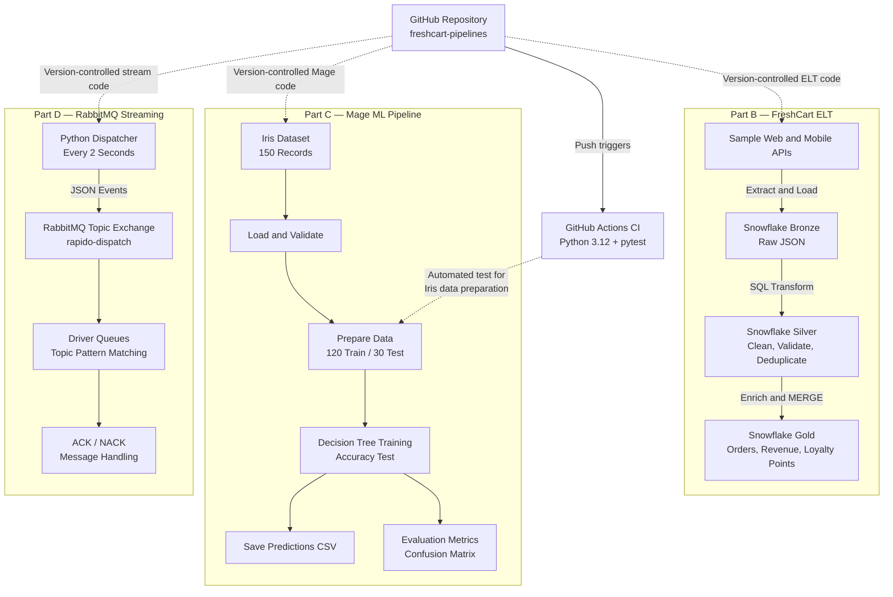

# Part E — End-to-End Data Engineering Architecture

## Architecture Explanation

The GitHub repository stores the source code for the FreshCart ELT, Mage ML, and RabbitMQ streaming components. GitHub Actions automatically executes Python tests when changes are pushed.

The FreshCart ELT pipeline loads raw API data into Snowflake Bronze, cleans and deduplicates records in Silver, and publishes business-ready orders in Gold.

The Mage pipeline independently loads the Iris dataset, validates it, prepares training and testing data, trains a decision-tree classifier, and exports predictions and evaluation results.

The RabbitMQ dispatcher independently publishes events to a topic exchange, which routes matching requests to private driver queues. Consumers use ACK for valid messages and NACK for malformed messages.

The diagram represents the overall architecture of the assignment. The Iris model does not directly train on FreshCart Gold data, and RabbitMQ events are not directly loaded into Snowflake in the implemented version.
